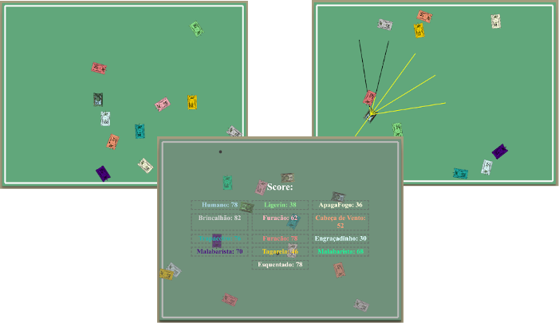

# Batalha de tanques em Prolog

Extensão acadêmica de uma simulação de batalha de tanques. O interesse está na relação entre sensores, regras de decisão e ações de agentes dentro de um ambiente visual.

**Inteligência Artificial · UFES · 2023/2**

SWI-Prolog · JavaScript · HTML · CSS

[English](README.en.md) · [Meu percurso em Ciência da Computação](https://github.com/Danilo-Js/My-Computer-Science-Course)

<p align="center"></p>

## O que este projeto explora

- Percepção do ambiente por sensores e estado do agente.
- Regras em Prolog para selecionar controles de movimento e combate.
- Comunicação entre servidor Prolog e simulação no navegador.

## Como explorar

| Caminho | Conteúdo |
|---|---|
| [Servidor HTTP e troca de dados](servidor.pl) | `servidor.pl` |
| [Controle de agentes](controle_tanques.pl) | `controle_tanques.pl` |
| [Regras do tanque](tanque0.pl) | `tanque0.pl` |
| [Configuração da simulação](main.js) | `main.js` |
| [Documentação técnica original](Documentacao.md) | `Documentacao.md` |

## Executar ou consultar

Instale SWI-Prolog e inicie o servidor a partir da raiz:

```bash
swipl -s servidor.pl
```

O arquivo inicia um servidor na porta 8080. Abra `index.html` conforme a configuração do navegador/ambiente local e confira os endereços usados pelo JavaScript. Execute as simulações Prolog deste acervo separadamente, pois usam a mesma porta.

## Conceitos e contexto

As imagens registram execuções demonstrativas. Pontuações e resultados de simulação não são apresentados como benchmark reproduzido ou desempenho comercial.

## Autoria e procedência

Trabalho apresentado por Danilo José Lima de Oliveira à disciplina de Inteligência Artificial, ministrada por Jacson Rodrigues Correia da Silva. Extensão de [jeiks/batalha_tanques](https://github.com/jeiks/batalha_tanques); os créditos e a procedência da base fazem parte deste projeto.

## Condições de uso

Este acervo não contém um arquivo LICENSE na raiz. Preserve os créditos de origem e confira as condições dos materiais antes de reutilizá-los.

## Projetos relacionados

- [prolog-car-race](https://github.com/Danilo-Js/prolog-car-race)
